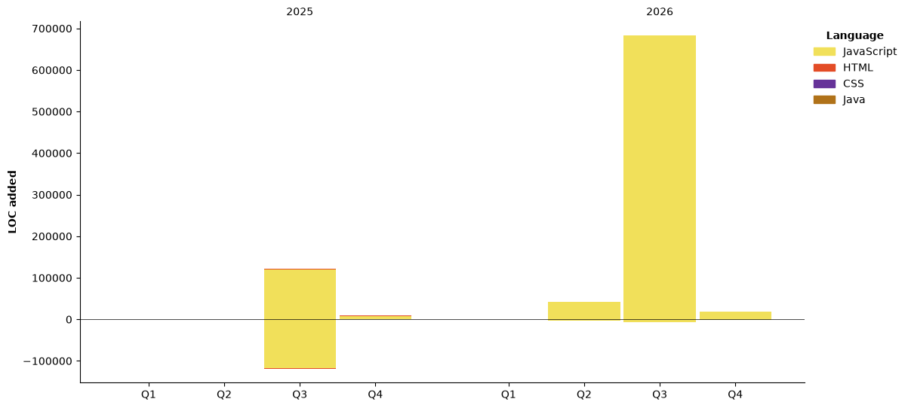

#  Hi, I'm Jengo Arnold


<!--START_SECTION:waka-->


**🐱 My GitHub Data** 

> 📦 ? Used in GitHub's Storage 
 > 
> 🏆 234 Contributions in the Year 2026
 > 
> 🚫 Not Opted to Hire
 > 
> 📜 9 Public Repositories 
 > 
> 🔑 0 Private Repositories 
 > 
**I'm a Night 🦉** 

```text
🌞 Morning                31 commits          ██░░░░░░░░░░░░░░░░░░░░░░░   07.56 % 
🌆 Daytime                93 commits          ██████░░░░░░░░░░░░░░░░░░░   22.68 % 
🌃 Evening                184 commits         ███████████░░░░░░░░░░░░░░   44.88 % 
🌙 Night                  102 commits         ██████░░░░░░░░░░░░░░░░░░░   24.88 % 
```
📅 **I'm Most Productive on Saturday** 

```text
Monday                   39 commits          ██░░░░░░░░░░░░░░░░░░░░░░░   09.51 % 
Tuesday                  52 commits          ███░░░░░░░░░░░░░░░░░░░░░░   12.68 % 
Wednesday                52 commits          ███░░░░░░░░░░░░░░░░░░░░░░   12.68 % 
Thursday                 72 commits          ████░░░░░░░░░░░░░░░░░░░░░   17.56 % 
Friday                   42 commits          ███░░░░░░░░░░░░░░░░░░░░░░   10.24 % 
Saturday                 97 commits          ██████░░░░░░░░░░░░░░░░░░░   23.66 % 
Sunday                   56 commits          ███░░░░░░░░░░░░░░░░░░░░░░   13.66 % 
```


📊 **This Week I Spent My Time On** 

```text
🕑︎ Time Zone: Europe/London

💬 Programming Languages: 
JavaScript               5 hrs 33 mins       █████████████░░░░░░░░░░░░   50.16 % 
TypeScript               1 hr 47 mins        ████░░░░░░░░░░░░░░░░░░░░░   16.12 % 
CSS                      1 hr 20 mins        ███░░░░░░░░░░░░░░░░░░░░░░   12.14 % 
Bash                     1 hr 13 mins        ███░░░░░░░░░░░░░░░░░░░░░░   11.00 % 
Other                    34 mins             █░░░░░░░░░░░░░░░░░░░░░░░░   05.17 % 

🔥 Editors: 
VS Code                  9 hrs               ████████████████████░░░░░   81.17 % 
Copilot CLI              2 hrs 5 mins        █████░░░░░░░░░░░░░░░░░░░░   18.83 % 
```

🤖 **AI Coding This Week** 

```text
⏱ AI Coding Time: 2 hrs 22 mins (21.45%)

✍️ 1,594 lines written by AI, 474 lines written by hand (77.08% AI-written)

🔤 22,604,768 Input Tokens, 4,704,839 Output Tokens

💵 $11.40 Estimated AI Cost This Week

🧠 9 AI Sessions, 25 AI Prompts

GPT                      2,204 lines         █████████████████████████   100.00 % 

🔎 AI Coding Insights:
🤖 AI-Driven — 77.08% of written lines came from AI
📝 Concise Prompter — average 80 characters per prompt
🔁 Iterative Prompter — average 3 prompts per session
🚀 High AI Trust — 27.62% of changed lines were hand-edited
```

**I Mostly Code in JavaScript** 

```text
JavaScript               9 repos             ███████████░░░░░░░░░░░░░░   42.86 % 
HTML                     7 repos             ████████░░░░░░░░░░░░░░░░░   33.33 % 
TypeScript               1 repo              █░░░░░░░░░░░░░░░░░░░░░░░░   04.76 % 
Dart                     1 repo              █░░░░░░░░░░░░░░░░░░░░░░░░   04.76 % 
CSS                      1 repo              █░░░░░░░░░░░░░░░░░░░░░░░░   04.76 % 
```


**Timeline**




 Last Updated on 01/11/2026 04:30:25 UTC
<!--END_SECTION:waka-->
